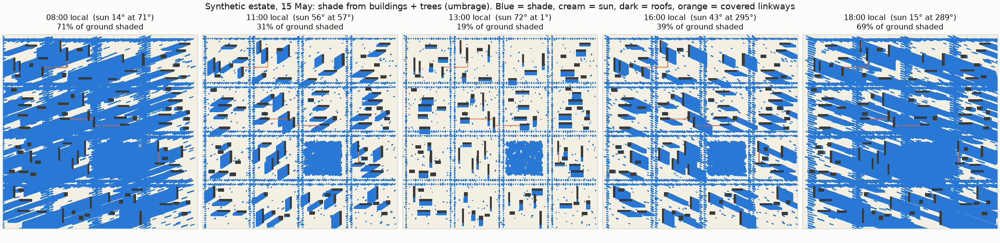

# Umbrage

*Umbrage: shade, from Latin* umbra.

Fast 2.5D shade from raster surface models. One small, tested shadow-casting kernel that runs on
numpy, on torch (CPU, Apple MPS, CUDA), or through UMEP's Rust `solweig` on the GPU. Built for
binary shade at 1 m over large areas: many timesteps, buildings and vegetation, no radiation budget.



*A synthetic 1.2 x 1.2 km estate at 1 m: shade from buildings and trees at five times of day.
No real data; see [the benchmark](benchmarks/results/2026-10-05_synthetic_estate/).*

## Quick start

```python
from datetime import datetime
from zoneinfo import ZoneInfo

import numpy as np
from umbrage import cast_shadows, solar_position

# 200 x 200 m at 1 m: flat ground at 0 m, one 20 m block, one tree
dsm = np.zeros((200, 200), np.float32)
dsm[90:110, 60:100] = 20.0
canopy_top = np.full_like(dsm, np.nan)
canopy_base = np.full_like(dsm, np.nan)
canopy_top[40:52, 140:152] = 12.0          # crown from 4 m to 12 m
canopy_base[40:52, 140:152] = 4.0

when = datetime(2026, 6, 21, 15, 0, tzinfo=ZoneInfo("Europe/Amsterdam"))
sun = solar_position(when, 52.37, 4.90)
r = cast_shadows(dsm, res=1.0, azimuth=sun.azimuth, elevation=sun.elevation,
                 canopy_top=canopy_top, canopy_base=canopy_base, tau=0.03)
# with torch installed: cast_shadows(..., device="mps") or device="cuda"

r.building, r.vegetation, r.shade          # bool, bool, float32 in [0, 1]
```

Shaded hours over a day:

```python
from datetime import date, time
from umbrage import daylight_timesteps

ams = ZoneInfo("Europe/Amsterdam")
steps = daylight_timesteps(date(2026, 6, 21), 52.37, 4.90, step_minutes=30, min_elevation=5.0,
                           tz=ams, start=time(4, 0), end=time(23, 0))
hours = sum(0.5 * cast_shadows(dsm, 1.0, s.azimuth, s.elevation).building for s in steps)
```

**Time zones:** in 0.1 the date helpers (`daylight_timesteps`, `umbrage.dates`) default to UTC+8 and
a 06:00 to 20:00 window. Always pass `tz`, and `start` / `end` outside the tropics. From 0.2, `tz`
will be required and the window will default to the whole day.

## What is in here

| Module | Does |
|---|---|
| `umbrage.sun` | Solar position (NOAA algorithm, no dependencies; checked against pvlib to < 0.05 deg), declination and equation of time |
| `umbrage.shade` | Shift-and-compare shadow casting (Ratti & Richens 2004), numpy or torch |
| `umbrage.tiling` | Tiles with halos for grids that do not fit in memory |
| `umbrage.dates` | Representative dates: a few days that stand for a whole year (Chebyshev nodes in declination, weights on the actual days of a year) |
| `umbrage.backends.solweig_rs` | Optional wrapper around UMEP's Rust shadowing (`pip install solweig`, GPL-3.0) |

## Inputs and semantics

All heights are absolute (m) on one grid. `dsm` = terrain + opaque obstacles (buildings, roofs of
covered walkways, bridges). `canopy_top`, `canopy_base` = crown top and base, NaN where there is no
vegetation; light passes crowns with transmissivity `tau`.

Outputs:
- `building`: the cell is shaded by the dsm
- `vegetation`: the ray from the cell towards the sun passes through a crown, whether or not the cell
  is also in building shade
- `shade`: 1 where `building`, else 1 - `tau` where `vegetation`, else 0

Conventions: azimuth in degrees clockwise from true north, elevation in degrees above the horizon
(refraction-corrected), timestamps timezone-aware. NaN in `dsm` means no data: such a cell casts no
shadow and is never reported as shaded, so fill nodata before casting.

Edges: obstacles outside the array are invisible. Tile with a halo at least as long as the longest
shadow you model (`umbrage.tiling`), or cap shadow length with `max_distance_m`.

## Engines

- **numpy** (default): the reference implementation.
- **torch** (`device="cpu" | "mps" | "cuda"`): the same code on torch tensors, numerically identical
  to numpy (enforced by `tests/test_backends.py`).
- **solweig** (`umbrage.backends.solweig_rs`): UMEP's Rust shadowing, on the CPU or on the GPU
  (WebGPU; Metal on a Mac). On a Mac it is the fastest path for many timesteps, and umbrage numpy is
  the check on it.

**A guard in the solweig wrapper.** `solweig` 0.1.0b96 keeps the last uploaded DSM and canopy arrays
on the GPU and skips the upload when the next call passes arrays with the same memory address and
shape. When a caller frees one array and allocates the next of the same shape, the allocator often
returns the same address, and the GPU then shades the previous DSM without raising an error. The
wrapper holds a reference to the arrays it last passed, so their addresses cannot be reused, and
copies an array whose contents changed in place. `tests/test_solweig_gpu_cache.py` reproduces the
failure with a fake backend and, on a machine with a GPU, compares GPU and CPU over a sequence of
different DSMs. Run it after every `solweig` upgrade.

## Differences from UMEP

SOLWEIG reports 1 = sunlit, and its vegetation shadow excludes cells already in building shadow.
Against `solweig` 0.1.0b96 on a synthetic estate over a full day (23 timesteps), building shade
agrees on 99.93 to 100% of ground cells and combined shade on 99.64 to 100%; see
[`benchmarks/results/2026-10-05_synthetic_estate/`](benchmarks/results/2026-10-05_synthetic_estate/).

## What it does not do

- 2.5D only: one height per cell, so no overhangs, arcades or shade under a raised floor. Model
  those as receiver classes upstream, or use a 3D mesh tool.
- No shadows on facades, no sky view factor, no radiation or mean radiant temperature. For those,
  use [UMEP / SOLWEIG](https://umep-docs.readthedocs.io/).
- Crowns are one top and one base per cell with a single transmissivity; there is no leaf-area model.

## Install and test

The `umep` extra (`solweig`) needs Python 3.11 to 3.13. On a Mac with a newer system Python,
`brew install python@3.12` and create the venv with `/opt/homebrew/bin/python3.12`.

```bash
git clone https://github.com/lukasbeuster/umbrage.git && cd umbrage
python3.12 -m venv .venv && source .venv/bin/activate
pip install -e ".[torch,umep,dev]"
pytest
python benchmarks/bench_engines.py --size 4000    # seconds per km2 on this machine
```

Tests that need `torch`, `solweig` or a GPU skip themselves when those are missing. To use Umbrage in
another project, install it from a release tag and pin the version:
`pip install "umbrage @ git+https://github.com/lukasbeuster/umbrage@v0.1.0"`.

## References

- Ratti, C. F., & Richens, P. (2004). Raster analysis of urban form. *Environment and Planning B:
  Planning and Design*, 31(2), 297-309.
- NOAA Global Monitoring Laboratory, solar calculation details (after Meeus, *Astronomical Algorithms*).
- Lindberg, F., et al. (2018). Urban Multi-scale Environmental Predictor (UMEP): an integrated tool
  for city-based climate services. *Environmental Modelling & Software*, 99, 70-87.

## Licence and citation

MIT, see [LICENSE](LICENSE). The optional `solweig` backend is a separate package under GPL-3.0; it is
not bundled with Umbrage and is imported only when you use `umbrage.backends.solweig_rs`.

Created by Lukas Beuster. Until a DOI is available, please cite the repository and the release tag
you used.
